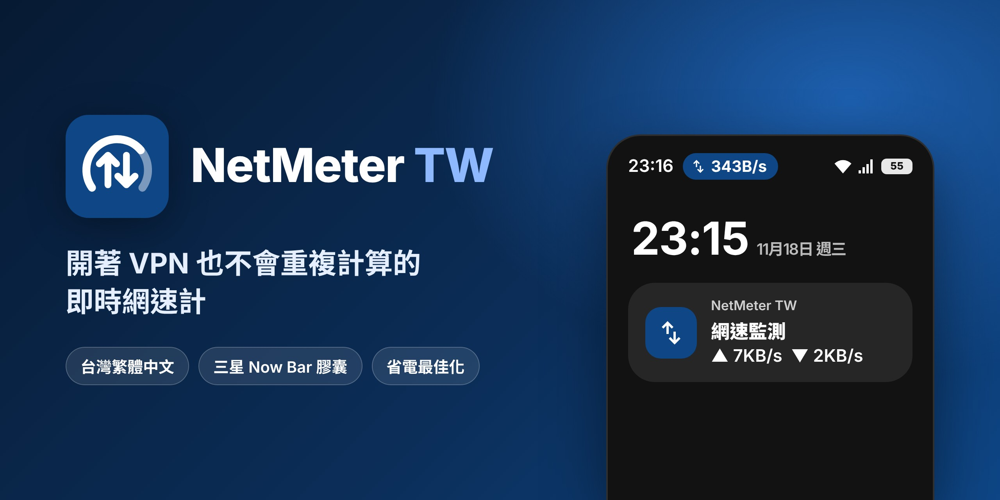

# NetMeter TW

<p align="center">
  
</p>

<p align="center">
  <strong>開著 VPN 也不會重複計算的即時網速計，支援台灣繁體中文與三星 One UI。</strong>
</p>

<p align="center">
  <a href="https://github.com/candy999/NetMeter-TW/releases/latest"></a>
  <a href="https://github.com/candy999/NetMeter-TW/actions/workflows/build-apk.yml"></a>
  <a href="LICENSE"></a>
</p>

<p align="center">
  繁體中文（台灣） · <a href="README_EN.md">English</a> · <a href="README_CN.md">简体中文</a>
</p>

NetMeter TW 是 Pixel Tailor CN 開發的 [Pixel Meter](https://github.com/Pixel-Tailor-CN/PixelMeter) 的分支版本。原版準確計速的做法全部保留，另外加上：

- **台灣繁體中文介面**，用台灣用語從原意翻譯，不是簡轉繁。
- **三星 One UI 支援**：可以在 Now Bar 和狀態列膠囊顯示網速，並提供三星專屬的設定引導。
- **省電與準確度改善**：關閉螢幕後更快停止取樣、減少通知更新、切換 Wi-Fi 與行動網路時不會暴衝。
- **獨立的應用程式 ID**（`io.github.candy999.netmeter`），可以**和原版同時安裝**。

## 為什麼準確

很多網速 App 會把實體網路和 VPN 通道的流量都算進去，顯示的網速會變成實際的兩倍左右。NetMeter TW 用 `ConnectivityManager.NetworkCallback` 找出 Wi-Fi、行動網路和乙太網路，排除 `TRANSPORT_VPN` 類型的網路，再用 `TrafficStats` 讀取每個實體介面的流量。不用靠 `tun0` 黑名單，也不需要 Root、Shizuku 或 ADB。

## 下載

| 管道 | 說明 |
|---|---|
| [Releases](https://github.com/candy999/NetMeter-TW/releases/latest) | 正式簽章版 APK，建議使用。 |
| [Actions › Build APK](https://github.com/candy999/NetMeter-TW/actions/workflows/build-apk.yml) | 每次更新程式碼都會產生的測試版 APK。點進任一次執行，在頁面下方的 **Artifacts** 下載 `NetMeterTW-apk`，需要登入 GitHub。 |

本 App 沒有上架 Google Play。正式版和測試版的簽章可能不同；如果 Android 提示無法更新，請先解除安裝另一個版本再安裝，App 的設定會被清除。

## 功能

- **狀態列網速**
  - 動態繪製的通知小圖示，可以顯示總網速、上傳或下載。
  - 可以自訂前綴、圖示文字大小、通知顏色和低流量門檻。
- **即時更新（Android 16 以上）**：透過 Android 的常駐通知升級功能，在狀態列顯示網速膠囊。三星手機還會出現在 Now Bar，請見[三星 One UI](#三星-one-ui)。
- **降低通知重要性**：把監測通知移到通知面板底部的靜音區，不和訊息通知搶位置，適合搭配即時更新膠囊使用。
- **浮動視窗**：可以拖曳，支援水平或垂直排列，顏色、圓角、內距、對齊都能調整。可以鎖定位置，也可以設定在橫向、沉浸模式或持續低流量時自動隱藏。
- **快速設定方塊**：從快速設定面板直接開關通知網速和浮動視窗。
- **Material You**：預設使用固定主題色 `#0E4686`，也支援動態配色和 AMOLED 純黑。
- **單位**：位元組（B/s）或十進位位元（b/s）。
- **設定精靈**：只要求你所選顯示方式需要的權限。
- **Cloudflare 測速**捷徑。
- **重視隱私**：沒有數據分析、沒有廣告 SDK，也不會上傳任何流量資料。

## 三星 One UI

One UI 用自己的 Now Bar 機制處理常駐通知，不在三星白名單裡的 App 送出標準 Android 即時更新會被忽略。在三星手機上，NetMeter TW 會加上社群研究發現、三星系統會接受的 Now Bar 專用參數。

| One UI 版本 | 即時更新膠囊／Now Bar |
|---|---|
| 9.0（Android 17） | 預期可用 |
| 8.5 | 預期可用 |
| 8.0 以下 | 無法使用，請改用通知小圖示或浮動視窗 |

膠囊沒有出現時，請依序確認：

1. App 內「設定 › 通知 › 啟用即時更新」已打開。
2. 「即時更新權限」顯示「已允許」；如果沒有，輕觸它就會開啟系統設定。
3. 如果有安裝 Good Lock 的 **QuickStar**，確認「Ongoing Chip」沒有被關閉。

**關於「Gemini Intelligence」名稱：** 加上三星專用參數後，One UI 會把膠囊和 Now Bar 卡片標示成「Gemini Intelligence」。要顯示本 App 自己的名稱，請到「開發人員選項」啟用「所有應用程式的即時通知」（Live notifications for all apps，名稱可能因 One UI 版本而異）。App 偵測到這個開關已啟用，就會自動停止附加參數。「設定 › 通知 › Now Bar 標示模式」也可以手動指定。

為了避免監測被系統停止，請把 App 加入「設定 › 電池 › 背景使用限制 › 永不睡眠的應用程式」。App 的「背景設定」裡有相關說明的連結。

其他注意事項：

- **通知圖示數量限制：** One UI 7 以後，狀態列預設只顯示有限數量的通知圖示，通知一多，網速圖示可能會被收進一個點裡。可以到「設定 › 通知 › 進階設定」調整。
- **三星未公開參數：** 這些參數三星沒有公開，未來的 One UI 版本可能失效。失效時 App 會退回標準 Android 行為，不會因此壞掉。

## 系統需求

- Android 12（API 31）以上。
- Android 13 以上需要通知權限，才能使用通知網速和即時更新。
- 只有浮動視窗需要「顯示在其他應用程式上層」權限。
- 監測期間 Android 規定一定要有常駐通知；關閉動態通知網速時，會保留一個最精簡的服務通知。

## 耗電行為

- 依你設定的間隔（1 到 3 秒）取樣，不使用 wakelock 或鬧鐘喚醒。
- 關閉螢幕 10 秒後停止取樣，開啟螢幕後自動恢復。
- 只有狀態列顯示的內容改變時才更新通知；只出現在通知欄的文字，最多每 10 秒更新一次。

## 編譯

### GitHub Actions

| Workflow | 觸發時機 | 產出 |
|---|---|---|
| `build-apk.yml` | 推送到 `master` 或 `claude/**` 分支，或手動執行 | APK 檔案。設好簽章 Secrets 時是正式簽章版，否則是用快取金鑰簽章的 debug 版。同時執行 lint。 |
| `release.yml` | 推送 `v*` 標籤 | 建立 GitHub Release，附上正式簽章的 APK 和 AAB，說明文字取自 `RELEASE_NOTES.md`。 |

正式簽章需要在「Settings › Secrets and variables › Actions」設定兩個 Secrets：

| Secret | 內容 |
|---|---|
| `SIGN_KEY_STORE_BASE64` | 金鑰檔（keystore）轉成 Base64 的文字 |
| `SIGN_KEY_STORE_PASSWORD` | 金鑰檔的密碼 |

`SIGN_KEY_ALIAS`（預設 `netmeter`）和 `SIGN_KEY_PASSWORD`（預設和金鑰檔密碼相同）可以不設。請不要把金鑰檔 commit 進儲存庫；`*.jks` 已經加入 `.gitignore`。

### 本機編譯

需要 JDK 21，以及安裝了 platform `android-37` 和 build-tools `37.0.0` 的 Android SDK。

```bash
./gradlew :app:assembleDebug
./gradlew lint
```

要在本機編譯正式版，請把 `SIGN_KEY_STORE_FILE`、`SIGN_KEY_STORE_PASSWORD`、`SIGN_KEY_ALIAS`、`SIGN_KEY_PASSWORD` 寫進 `local.properties`（這個檔案不會被 commit），再執行 `./gradlew :app:assembleRelease`。

## 架構

單一模組 MVVM，使用 Kotlin、Jetpack Compose、Material 3、Koin 和 Preferences DataStore。

```text
SpeedDataSource → NetworkRepository → NetworkMonitorService → NotificationHelper / OverlayWindow
```

架構、通知、浮動視窗和本地化的詳細文件在 [`docs/README.md`](docs/README.md)（英文）。開發者與程式代理的協作規則請見 [`AGENTS.md`](AGENTS.md)。

## 語言

英文、繁體中文（台灣）、簡體中文、葡萄牙文、巴西葡萄牙文、俄文。

繁體中文（台灣）由本儲存庫維護，歡迎直接發 Pull Request 改善翻譯。其他語言來自原專案，由原專案在 [Weblate](https://hosted.weblate.org/engage/pixel-meter/) 管理。

## 參與貢獻

歡迎回報 Issue 或發 Pull Request。程式註解、文件和 commit 訊息請用英文，Issue 和 Pull Request 可以用中文或英文。詳見 [CONTRIBUTING.md](CONTRIBUTING.md) 和 [AGENTS.md](AGENTS.md)。

## 隱私

流量計數和設定都只在你的裝置上處理，詳見 [PRIVACY_POLICY.md](PRIVACY_POLICY.md)。

## 致謝與授權

- 原始 App：Pixel Tailor CN 的 [Pixel Meter](https://github.com/Pixel-Tailor-CN/PixelMeter)，採用 Apache-2.0 授權。
- 三星 Now Bar 的研究成果：[tigerduck-app-android](https://github.com/tigerduck-app/tigerduck-app-android/pull/126)。
- 本分支同樣採用 [Apache License 2.0](LICENSE) 授權，與 Google、三星及原作者沒有任何關係。
