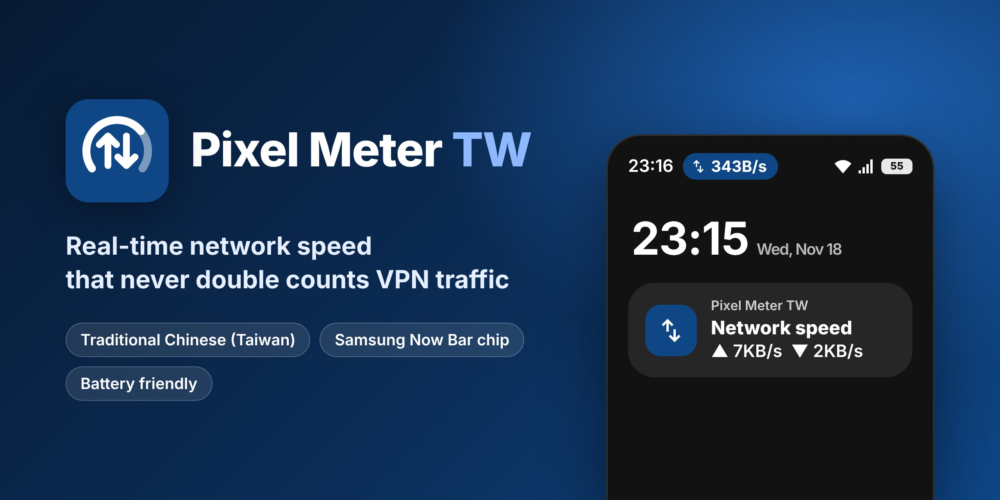

# Pixel Meter TW

<p align="center">
  
</p>

<p align="center">
  <strong>A real-time network speed meter that never double counts VPN traffic, with Traditional Chinese (Taiwan) and Samsung One UI support.</strong>
</p>

<p align="center">
  <a href="https://github.com/candy999/NetMeter-TW/releases/latest"></a>
  <a href="https://github.com/candy999/NetMeter-TW/actions/workflows/build-apk.yml"></a>
  <a href="LICENSE"></a>
</p>

<p align="center">
  English · <a href="README_TW.md">繁體中文（台灣）</a> · <a href="README_CN.md">简体中文</a>
</p>

Pixel Meter TW is a fork of [Pixel Meter](https://github.com/Pixel-Tailor-CN/PixelMeter) by Pixel Tailor CN. It keeps everything that makes the original accurate and adds:

- A full **Traditional Chinese (Taiwan)** interface written with Taiwan terminology, not converted from Simplified Chinese.
- **Samsung One UI support** for the Now Bar and status bar chip, plus Samsung-specific setup guidance.
- **Battery and accuracy improvements**, such as faster screen-off sleep, fewer notification refreshes, and no speed spikes when switching between Wi-Fi and cellular.
- A separate application ID (`io.github.candy999.netmeter`), so it installs **alongside the original app**.

## Why it is accurate

Many speed meters count traffic on both the physical network and the VPN tunnel, so the speed shown can be about twice the real value. Pixel Meter TW uses `ConnectivityManager.NetworkCallback` to find Wi-Fi, cellular, and Ethernet networks, excludes networks with `TRANSPORT_VPN`, and reads each physical interface with `TrafficStats`. It does not rely on a `tun0` blacklist, and needs no Root, Shizuku, or ADB.

## Download

| Channel | What you get |
|---|---|
| [Releases](https://github.com/candy999/NetMeter-TW/releases/latest) | Signed release APK. Recommended. |
| [Actions › Build APK](https://github.com/candy999/NetMeter-TW/actions/workflows/build-apk.yml) | A test APK for every push. Open a run and download `PixelMeterTW-apk` from **Artifacts** (GitHub sign-in required). |

The app is not on Google Play. Release builds and Actions test builds may use different signatures. If Android refuses to update, uninstall the other build first; this clears the app's settings.

## Features

- **Status bar speed**
  - A dynamic Bitmap small icon showing total, upload, or download speed.
  - Custom prefixes, icon text sizes, notification color, and a low-traffic threshold.
- **Live Update (Android 16+)**: a status bar chip through Android's promoted ongoing notifications. On Samsung, it also appears in the Now Bar; see [Samsung One UI](#samsung-one-ui).
- **Floating window**: a draggable Overlay with horizontal or vertical layout, colors, corner radius, padding, and alignment. It can lock its position, and can hide in landscape, in immersive apps, or while traffic stays low.
- **Quick Settings Tiles** to toggle notification speed and the floating window.
- **Material You**: Dynamic Color, a fixed theme color, and optional AMOLED black.
- **Units**: bytes/s, or decimal SI bits/s.
- **Setup wizard** that asks only for the permissions the chosen display needs.
- **Cloudflare speed test** shortcut.
- **Privacy**: no analytics, no ads SDK, and no traffic upload.

## Samsung One UI

One UI handles ongoing notifications through its own Now Bar pipeline, which ignores standard Android Live Updates from apps outside Samsung's allowlist. On Samsung devices, Pixel Meter TW adds the Now Bar extras that community research found Samsung SystemUI honors.

| One UI | Live Update chip / Now Bar |
|---|---|
| 9.0 (Android 17) | Expected to work |
| 8.5 | Expected to work |
| 8.0 and earlier | Not available; use the Bitmap icon or the floating window |

If the chip does not appear:

1. Turn on **Settings › Notifications › Enable Live Update** in the app.
2. Check that **Live Update permission** shows "Allowed". If it does not, tap it to open the system setting.
3. If Good Lock **QuickStar** is installed, make sure **Ongoing Chip** is not turned off.

To keep monitoring alive, add the app to **Settings › Battery › Background usage limits › Never sleeping apps**. The app's Background settings link to a guide.

Other notes:

- **Notification icon limit:** One UI 7 and later shows a limited number of notification icons in the status bar by default, so the Bitmap icon can be hidden behind a dot when many notifications arrive. You can change this under **Settings › Notifications › Advanced settings**.
- **Undocumented extras:** these keys are private to Samsung and may stop working in a future One UI release. If they do, the app falls back to standard Android behavior.

## Requirements

- Android 12 (API 31) or later.
- Notification permission is needed on Android 13+ for notification speed and Live Update.
- The "Display over other apps" permission is needed only for the floating window.
- Android requires an ongoing notification while monitoring runs. If dynamic notification speed is off, a minimal service notification remains.

## Battery behavior

- Sampling runs at the interval you choose (1–3 seconds), using no wakelocks or alarms.
- Sampling stops 10 seconds after the screen turns off and resumes when it turns on.
- The notification is reposted only when the status bar output changes. Text that appears only in the notification drawer refreshes at most every 10 seconds.

## Building

### GitHub Actions

| Workflow | Trigger | Output |
|---|---|---|
| `build-apk.yml` | Every push to `master` or `claude/**`, or manual run | APK artifact. Release-signed when signing secrets exist; otherwise debug-signed with a cached keystore. Also runs lint. |
| `release.yml` | Pushing a `v*` tag | Signed APK and AAB attached to a GitHub Release, with notes from `RELEASE_NOTES.md`. |

Release signing needs two repository secrets (**Settings › Secrets and variables › Actions**):

| Secret | Value |
|---|---|
| `SIGN_KEY_STORE_BASE64` | The keystore file encoded as Base64 |
| `SIGN_KEY_STORE_PASSWORD` | The keystore password |

`SIGN_KEY_ALIAS` (default `netmeter`) and `SIGN_KEY_PASSWORD` (default: the store password) are optional. Never commit a keystore. `*.jks` is ignored by Git.

### Local build

Requirements: JDK 21 and an Android SDK with platform `android-37` and build-tools `37.0.0`.

```bash
./gradlew :app:assembleDebug
./gradlew lint
```

For a local release build, put `SIGN_KEY_STORE_FILE`, `SIGN_KEY_STORE_PASSWORD`, `SIGN_KEY_ALIAS`, and `SIGN_KEY_PASSWORD` in `local.properties`, which is not committed, then run `./gradlew :app:assembleRelease`.

## Architecture

Kotlin, Jetpack Compose, Material 3, Koin, and Preferences DataStore in a single-module MVVM app.

```text
SpeedDataSource → NetworkRepository → NetworkMonitorService → NotificationHelper / OverlayWindow
```

See [`docs/README.md`](docs/README.md) for the architecture, notification, Overlay, and localization documents. Collaboration rules for people and coding agents are in [`AGENTS.md`](AGENTS.md).

## Languages

English, Traditional Chinese (Taiwan), Simplified Chinese, Portuguese, Brazilian Portuguese, and Russian.

Traditional Chinese (Taiwan) is maintained in this repository; improvements are welcome as pull requests. The other translations come from the upstream project, which manages them on [Weblate](https://hosted.weblate.org/engage/pixel-meter/).

## Contributing

Issues and pull requests are welcome. Code comments, documentation, and commit messages are written in English; Issues and pull requests may be in English or Chinese. See [CONTRIBUTING.md](CONTRIBUTING.md) and [AGENTS.md](AGENTS.md).

## Privacy

Traffic counters and settings are processed only on the device. See [PRIVACY_POLICY.md](PRIVACY_POLICY.md).

## Credits and license

- Original app: [Pixel Meter](https://github.com/Pixel-Tailor-CN/PixelMeter) by Pixel Tailor CN, licensed under Apache-2.0.
- Samsung Now Bar findings: [tigerduck-app-android](https://github.com/tigerduck-app/tigerduck-app-android/pull/126).
- This fork is distributed under the same [Apache License 2.0](LICENSE). It is not affiliated with Google, Samsung, or the original authors.
